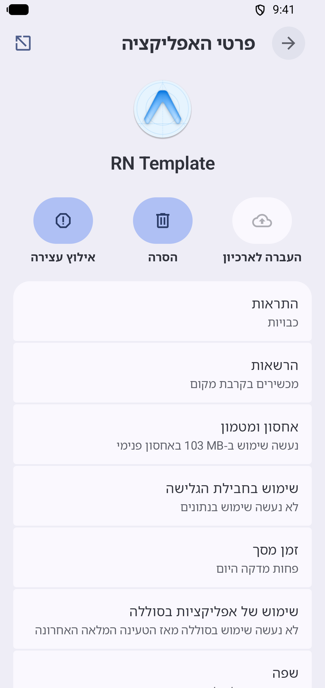
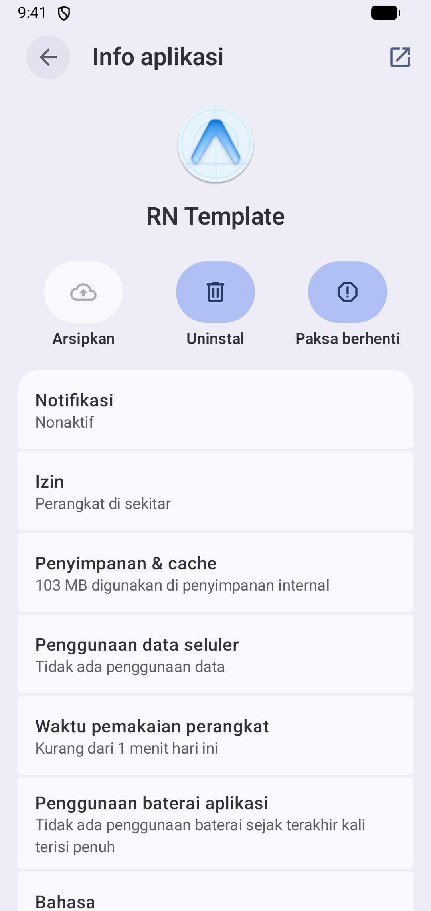

# Android resource qualifiers for `he` / `id` / `zh-Hans` / `zh-Hant` don't match where Android and libraries look

Created with `npx create-expo-app@latest --template blank@sdk-57`, then:

- `npx expo install expo-localization`
- `app.json`: `android.package` set; `expo-localization` plugin with
  `supportedLocales.android: ["en", "fr", "he", "id", "zh-Hans", "zh-Hant"]`;
  `locales` with `fr`, `he`, `id`
- `locales/{fr,he,id}.json`: a translated Android `app_name` (`Repro FR`, `Repro HE`, `Repro ID`).
  French is the control.

Versions: `expo` 57.0.27, `@expo/config-plugins` 57.0.10, `expo-localization` 57.0.2.

## Steps

```sh
npm install
npx expo prebuild --platform android --no-install
ls android/app/src/main/res | grep values-b
grep resourceConfigurations android/app/build.gradle
cd android && ./gradlew :app:processDebugResources
AP=app/build/intermediates/linked_resources_binary_format/debug/processDebugResources/linked-resources-binary-format-debug.ap_
"$ANDROID_HOME"/build-tools/<version>/aapt2 dump resources "$AP" > dump.txt
grep -A5 'string/app_name$' dump.txt
grep -A10 'string/abc_action_bar_up_description$' dump.txt
for q in fr he iw id in zh-rCN zh-rTW zh-rHK; do echo "$q: $(grep -c "^ *($q) " dump.txt)"; done
```

## Actual

Prebuild writes the modern codes:

```text
values-b+fr
values-b+he
values-b+id
        resourceConfigurations += ["b+en", "b+fr", "b+he", "b+id", "b+zh+Hans", "b+zh+Hant"]
```

`aapt2 dump resources`:

```text
    resource 0x7f0f001f string/app_name
      () "Repro"
      (id) "Repro ID"
      (he) "Repro HE"
      (fr) "Repro FR"
    resource 0x7f0f0003 string/abc_action_bar_up_description
      () "Navigate up"
      (fr) "Revenir en haut de la page"
```

| Qualifier | `fr` | `he` | `iw` | `id` | `in` | `zh-rCN` | `zh-rTW` | `zh-rHK` |
| --- | --- | --- | --- | --- | --- | --- | --- | --- |
| Entries | 141 | 1 | 0 | 1 | 0 | 0 | 0 | 0 |

- Hebrew and Indonesian: only the app's own `app_name` is kept, under `(he)` / `(id)`. Android never serves
  these qualifiers (`ResourcesImpl.adjustLanguageTag` maps `he`→`iw`, `id`→`in` before lookup), so a device
  set to `he-IL` or `id-ID` shows the default name. The filter also strips every library translation for these
  languages, shipped under `values-iw` / `values-in`.
- Chinese: AppCompat ships its translations under `values-zh-rCN`, `values-zh-rTW`, `values-zh-rHK`. The
  `b+zh+Hans` / `b+zh+Hant` filter strips them all.

## Expected

Same project, after renaming `values-b+he` → `values-b+iw`, `values-b+id` → `values-b+in`, and editing the
filter to
`["b+en", "b+fr", "b+iw", "b+in", "b+zh+Hans", "b+zh+Hant", "zh-rCN", "zh-rTW", "zh-rHK"]`:

```text
    resource 0x7f0f001f string/app_name
      () "Repro"
      (in) "Repro ID"
      (fr) "Repro FR"
      (iw) "Repro HE"
    resource 0x7f0f0003 string/abc_action_bar_up_description
      () "Navigate up"
      (in) "Kembali ke atas"
      (fr) "Revenir en haut de la page"
      (iw) "ניווט למעלה"
      (zh-rHK) "向上瀏覽"
      (zh-rCN) "转到上一层级"
      (zh-rTW) "向上瀏覽"
```

| Qualifier | `fr` | `he` | `iw` | `id` | `in` | `zh-rCN` | `zh-rTW` | `zh-rHK` |
| --- | --- | --- | --- | --- | --- | --- | --- | --- |
| Entries | 141 | 0 | 143 | 0 | 118 | 142 | 142 | 142 |

## On a device

`screenshots/` comes from a larger app built on the same SDK and the same config shape (emulator, API 37),
whose English name is `RN Template` and Hebrew name `תבנית RN`. App info in Settings:

| `he-IL`, as generated | `he-IL`, moved to `iw` | `id-ID`, as generated |
| --- | --- | --- |
|  |  |  |
